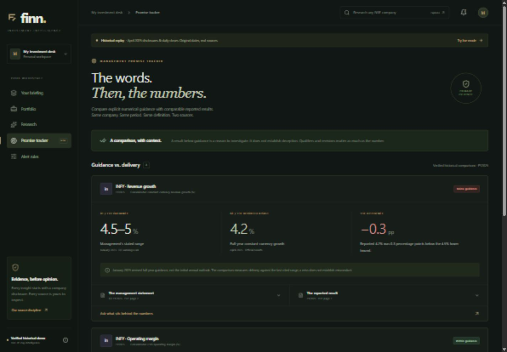
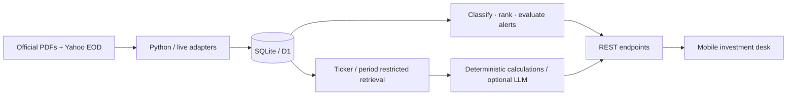

# FINN — Investment Intelligence

**An investor should know what changed, why it matters, and where the evidence is—in 30 seconds.**

FINN is a mobile-first working prototype for the ENAM Holdings AI Engineer Build Challenge. It replaces an undifferentiated feed with a considered loop: **discover → understand → inspect → investigate**.

[Deployed FINN](https://finn-investment-intelligence-mrity.hazyanole2049.chatgpt.site) · [Demo walkthrough](docs/DEMO.md) · [Architecture](docs/ARCHITECTURE.md) · [Verification](docs/VERIFICATION.md)

The Site starts private and requires the owner's sign-in. A judge-facing audience must be explicitly configured before submission. The GitHub account is not connected in this environment; the local repository and source-hosted deployment are prepared, but no GitHub URL is claimed.



## What works

- An 18-company, diverse Indian watchlist; add/remove companies and persist choices in SQLite.
- A default 24-hour/date-only briefing, 7-day and custom windows, company/category filters, transparent attention scores, and collapsed lower-priority updates.
- Real EOD price/volume triggers with configurable thresholds, prior-session lookbacks, and company overrides.
- Evidence drawers with original PDF links, supporting passages, source-linked quarterly Revenue/EBITDA/PBT/PAT, and deterministic QoQ/YoY calculations.
- Ticker-based research independent of portfolio membership. Cached examples include Asian Paints, Persistent Systems and Avenue Supermarts. An uncached COFORGE.NS request was tested through validation, discovery, extraction, indexing and cited retrieval.
- A visible management promise tracker: Infosys's January revised FY2025 revenue and operating-margin guidance versus subsequent official results.
- Credential-free research: original passages plus validated calculations. Optional server-side citation-constrained language-model synthesis.
- Honest loading, missing-evidence, unsupported-ticker, source-failure, incomplete-statement and empty-window states.

## Honest demo boundaries

The default is a **verified historical replay**, not a live trading terminal. It contains 576 authentic Yahoo daily observations from March–April 2025 and 11 retrieved primary documents across five companies. The curated briefing has four results/call updates for **two** portfolio companies. The UI explicitly shows this coverage gap; absence of a surfaced filing does not establish absence of an exchange disclosure.

The research library is historical. Large annual reports index a selected set of relevant pages. In live discovery, PDFs are limited to 8 MB and 500 pages; access restrictions, scans and oversized files return explicit limitations. There is no continuously scheduled exchange scraper, phone push service, investment recommendation engine or trading workflow. Ambiguous LLM classification, broad financial extraction and multi-company guidance extraction are deliberately deferred.

## Stack and architecture

React + TypeScript, Next.js App Router conventions through Vinext/Vite, Tailwind CSS, Lucide and Recharts. Same-origin REST handlers use Zod validation; Drizzle migrations manage SQLite on Cloudflare D1. Python uses httpx and pypdf for ingestion and independently validates the financial calculations.

The available host supports a single Worker and D1. This adapts the suggested FastAPI/SQLAlchemy split so the deployed app has a functioning persistent backend without an unprovisioned second service. The original challenge has no stack restriction. See [the decision and trade-offs](docs/ARCHITECTURE.md).



## Run locally

Use Node.js 24 (22.13+ supported), npm, and optionally Python 3.11+ for rebuilding data. No API keys are required.

```sh
npm ci
npm run build
npm run db:migrate:local
npm run dev -- --port 5173
```

Open [FINN locally](http://127.0.0.1:5173). The first API request imports the verified snapshot into the local database. Data persists in ignored `.wrangler/state/`. Local and deployed databases are separate. On Windows, use `npm.cmd` when PowerShell execution policy blocks `npm.ps1`.

To preview the production build, use `npm start`. To generate a new schema migration after changing `db/schema.ts`, use `npm run db:generate`; never modify an already applied migration.

## Environment

Copy `.env.example` to `.dev.vars` for local optional integrations. Configure hosted values as runtime secrets/variables, never in browser bundles or the hosting manifest.

| Variable        | Meaning                                                             |
| --------------- | ------------------------------------------------------------------- |
| `LLM_API_KEY`   | Optional provider key; empty uses deterministic/extractive research |
| `LLM_BASE_URL`  | HTTPS provider API base supporting `/chat/completions` JSON         |
| `LLM_MODEL`     | Provider model identifier; no hardcoded paid default                |
| `ADMIN_TOKEN`   | Bearer secret enabling ingestion endpoints; empty disables them     |
| `FINN_TEST_URL` | Integration-test origin; defaults to `http://127.0.0.1:5173`        |

The optional LLM provider path has no credentials in this submission and has not been externally tested with a key. The demonstrated core does not depend on it.

## Rebuild the verified data

The bundled snapshot is enough to run offline. Rebuilding requires public-source access; sites may restrict automated requests, and no bypass is attempted.

```sh
python -m pip install --target .python-libs -r requirements.txt
python scripts/ingest.py
python scripts/build-seed.py
python scripts/validate-financials.py
```

Use `py` instead of `python` on Windows if appropriate. `--documents-only`, `--market-only`, `--ticker SYMBOL` and `--live` narrow the ingestion job. Downloaded PDFs stay in ignored `data/sources/`; extracted source metadata is retained in `data/source-manifest.json`. The seed keeps SHA-256s of original PDFs and their actual page numbers. Every curated numeric extraction is checked against its cited page before building the snapshot.

## API

| Method    | Route                                              | Purpose                                               |
| --------- | -------------------------------------------------- | ----------------------------------------------------- |
| GET       | `/api/health`                                      | Runtime/database health and operating mode            |
| GET, POST | `/api/portfolio`                                   | Read portfolio / validate and add company             |
| DELETE    | `/api/portfolio/{ticker}`                          | Remove a company                                      |
| GET       | `/api/market/{ticker}`                             | Stored daily series; `mode=historical` or `live`      |
| POST      | `/api/market/refresh`                              | Retrieve completed recent sessions for a ticker       |
| GET       | `/api/digest`                                      | Windowed ranked filings and calculated EOD alerts     |
| GET       | `/api/announcements`, `/api/announcements/{id}`    | Filings and detailed evidence                         |
| GET, PUT  | `/api/alerts/settings`                             | Persistent global/category/company rules              |
| GET       | `/api/alerts`                                      | Stored in-app triggers                                |
| GET       | `/api/companies/search?q=...`                      | Cached search plus arbitrary ticker resolution        |
| GET       | `/api/companies/{ticker}/overview`                 | Documents, metrics, market series and guidance        |
| POST      | `/api/research`                                    | Grounded question with optional period/type filters   |
| GET       | `/api/research/{ticker}/documents`                 | Company source catalogue                              |
| GET       | `/api/research/{ticker}/guidance`, `/api/guidance` | Comparable guidance pairs                             |
| POST      | `/api/admin/ingest-market`                         | Protected market ingestion                            |
| POST      | `/api/admin/ingest-document`                       | Protected primary exchange PDF import                 |
| POST      | `/api/admin/ingest-announcements`                  | Protected filing import referencing an indexed source |

Errors are structured as `{ "error": { "code": "...", "message": "..." } }`. Ingestion endpoints require `Authorization: Bearer <ADMIN_TOKEN>` and are disabled without a configured token. Never put that token into the frontend.

## AI, retrieval and costs

FINN normalizes a ticker, looks up source documents, attempts discovery on a cache miss, extracts bounded PDF pages, chunks with overlap, retrieves company-scoped passages, computes supported financial comparisons, and optionally synthesizes an answer. Citation IDs and original locations accompany findings. Documents are untrusted data and have no execution path or access to secrets.

The default path makes **zero model calls**. It performs deterministic comparisons and displays retrieved quotations rather than pretending model memory is a source. With a provider configured, numeric comparisons still use code, while qualitative requests can use the configured model. Source and answer caching use document hashes, ticker, filters, question, pipeline version and model; changed documents invalidate stale analysis. Lexical retrieval keeps the small corpus inspectable and cheap. It is not a semantic vector search system.

## Calculation methodology

- Daily change uses consistent provider-adjusted closes, avoiding split-driven false moves.
- Relative volume = current session volume / average volume of the **previous N** sessions. The current session is excluded; an incomplete baseline is unavailable.
- QoQ and YoY = `(current − comparison) / comparison × 100`. Zero/negative bases are explicitly unavailable rather than misleading ratios.
- Financial figures preserve currency, units, consolidation basis, period and source page. Missing EBITDA is not inferred from operating profit.
- Guidance compares the same period and definition. A range miss is measured in percentage points from the nearest boundary. It is not a share-price forecast or a statement about intent.
- Live refresh excludes the current Indian calendar day to avoid reporting an unfinished session as an EOD close.

## Tests and validation

```sh
npm test
npm run typecheck
# With the local server running:
npm run test:api
python scripts/validate-financials.py
```

The suite covers numeric edge cases, prior-session volume, source provenance, period/basis alignment, classification, score bounds, duplicate constraints, owner isolation, date filtering, persistence, protected ingestion, cross-company retrieval, absent evidence, and guidance calculations. The API suite uses its own device session and restores modified settings/portfolio entries.

Browser verification uses 1440×1000 desktop and 390×844 mobile viewports. See [the actual verification record](docs/VERIFICATION.md). An end-to-end uncached-ticker test succeeded for COFORGE.NS, but does not imply every upstream document will be accessible.

## Source layout

```text
app/                 App shell, styles and same-origin REST routes
components/          Briefing, evidence, portfolio, research, tracker and rules
lib/domain.ts        Pure financial, ranking and retrieval functions
lib/research-analysis.ts  Deterministic source-linked financial findings
lib/server.ts        Persistent storage, adapters, retrieval and provider boundary
db/schema.ts         Normalized Drizzle schema
drizzle/             Versioned SQLite migrations
data/                Authentic source metadata, snapshot and Python audit
scripts/             Ingestion, audit, local migration and hosting helpers
tests/               Domain, database, research and HTTP integration checks
docs/                Architecture, demo, screenshots and submission materials
```

## Submission and next steps

The original brief asks for a mobile prototype, GitHub repository, genuine AI build history and covering note. [The covering note](docs/COVERING_NOTE.md) is drafted; it has **not** been emailed. Actual user-visible development messages and the supplied build prompt are preserved under `docs/development/`. That is a partial real export, not invented development history; keep the complete chat export/share link for submission.

Before submission, publish to the intended GitHub account and configure a demo audience assessors can access. Planned engineering work: scheduled approved source ingestion, broader exchange coverage, queued large-document parsing, FTS/BM25 or semantic retrieval, stricter model entailment validation, automated structured statement extraction, and more verified guidance comparisons.
