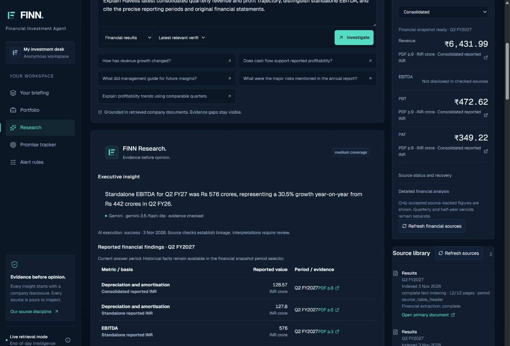

# FINN — AI Investment Intelligence Copilot

FINN turns company disclosures and completed market sessions into an evidence-grounded investment research workspace: a prioritised portfolio briefing, company research, financial snapshots and management guidance comparisons.

**[Open the live FINN demo](https://finn-enam-final-mrity.hazyanole2049.chatgpt.site/)** · **[ENAM reviewer guide](docs/SUBMISSION.md)** · **[Verification evidence](docs/test-results/submission/README.md)**

The public demo opens without signup. Each visitor receives an independent 18-company starter watchlist. **Latest EOD** is selected by default; the historical April 2025 replay is explicitly selectable.



## What FINN does

- **PUSH — portfolio intelligence:** ranks company announcements and unusual daily price/volume observations, explains their relevance and retains source-linked alerts.
- **PULL — company research:** searches supported NSE companies beyond the watchlist, discovers primary documents and produces Gemini research with inspectable page citations.
- **Financial Snapshot:** displays accepted source-backed metrics, periods, accounting bases, calculation inputs and evidence gaps. Consolidated and standalone figures stay separate.
- **Promise Tracker:** compares explicit management guidance with compatible reported results, preserving source statements, revisions and superseded targets.
- **Persistent workspace:** saves companies, preferences, notification states, indexed documents, extracted facts and resumable research jobs in SQLite/D1.

## Submission status

Verified **3 November 2026** on the public deployment, with localhost stopped:

| Area | Verified result |
| --- | --- |
| Portfolio and market data | All 18 starter companies priced; real Yahoo Finance refresh, daily changes and company add/remove persistence |
| Gemini research | Havells outside the test portfolio: real Gemini answer, eight checked page citations and recorded provider token usage |
| Financial extraction | Ajanta Q2 FY2027 Revenue, EBITDA, PBT and PAT accepted; Havells consolidated results and standalone EBITDA separately labelled |
| PUSH | Authentic 2 November 2026 ITC disclosures reached the briefing and persisted alerts |
| Promise Tracker | Four historical comparisons with original management and reported-result evidence |
| Responsive UI | Five mobile navigation sections exercised; research checked at 320, 375 and 1440 pixels without page overflow |
| Reliability | Shared discovery contention resumes; crawling has a common deadline; large catalogues use bounded D1 batches |
| Checks | TypeScript, lint, production builds, 109 unit/database tests and the documented API/regression suites passed |

The deployed application is **Sites version 4**, built from [`18416e11742d8478fc017928900bdd520407b08f`](https://github.com/mrityunjaykumar23/FINN/commit/18416e11742d8478fc017928900bdd520407b08f). Subsequent submission updates change documentation and review evidence only; application/runtime files remain identical to this verified build. See [release provenance and live results](docs/SUBMISSION.md).

## Architecture

| Layer | Implementation |
| --- | --- |
| Interface | React, TypeScript, Vinext/Vite and the responsive navy/teal FINN design |
| Backend | Cloudflare Worker with the existing same-origin REST API |
| Persistence | Cloudflare D1 / local SQLite, Drizzle migrations and FTS5 retrieval |
| Research | Native `@google/genai`, structured output validation, source/number checks and labelled fallback |
| Evidence | Primary company/exchange PDFs and supported structured filings; original URLs, pages, units and reporting contexts retained |
| Market data | Yahoo Finance completed EOD observations with freshness and adjusted-return checks |

See [Architecture](docs/ARCHITECTURE.md), [Database design](docs/DATABASE_DESIGN.md) and [AI pipeline](docs/AI_PIPELINE.md).

## Run locally

Use **Node.js 24** and npm, matching the tested environment. Python is optional for the independent financial audits.

```sh
git clone https://github.com/mrityunjaykumar23/FINN.git
cd FINN
npm ci
```

Create `.dev.vars` from [`.env.example`](.env.example) **only if it does not already exist**, then enter your server-side values locally. Preserve existing environment files and databases.

| Variable | Purpose |
| --- | --- |
| `GEMINI_API_KEY` | Server-only Gemini key |
| `AI_ENABLED` | `true` enables configured Gemini; `false` selects offline/extractive mode |
| `GEMINI_MODEL_FAST` | Configurable extraction/research model; deployed acceptance used `gemini-3.5-flash-lite` |
| `GEMINI_MODEL_REASONING` | Optional model for complex questions; defaults to the fast model |
| `ADMIN_TOKEN` | Long random secret for protected imports and administrative jobs |
| `SITES_SCHEDULED_TOKEN` | Optional secret for the protected hosted update endpoint |
| `PDF_MAX_MB`, `PDF_MAX_PAGES` | Bounded document processing limits |

Never commit credentials or local database files. Missing credentials or rejected provider output produce clearly labelled fallback results.

```sh
npm run db:migrate:local
npm run dev -- --host 127.0.0.1
```

Open **[http://127.0.0.1:5173](http://127.0.0.1:5173)**. A fresh database is seeded on its first request; each visitor receives the starter watchlist once. Removing all companies leaves an empty watchlist after refresh.

For a built Worker preview, stop the development server and run:

```sh
npm run build
npm start -- --port 5173
```

The launcher loads root `.dev.vars` as server bindings and retains data in ignored `.wrangler/state/`. Stop the preview before rebuilding or running migration maintenance on Windows. Back up an existing local database with `npm run db:backup`; legacy migration-ledger adoption is documented in [Database design](docs/DATABASE_DESIGN.md).

## Review and reproduce

Follow [the reviewer guide](docs/SUBMISSION.md) for a short assessment walkthrough. Use [the demo guide](docs/DEMO.md) for reproducible historical evidence, protected imports, job continuations and integration-fixture setup.

Core checks do not require a running server:

```sh
npm run typecheck
npm test
npm run lint
npm run build
```

HTTP suites require a running localhost Worker and their documented source/market fixtures. Current-alert checks need current live observations. Real Gemini tests require a valid key/model/quota and explicitly skip when unconfigured; a skip is not an integration pass.

```sh
npm run test:api
npm run test:gemini
npm run test:research-jobs
npm run test:reliability-api
npm run test:ingestion
```

`test:cache`, `test:demo` and `test:research-contention` use isolated localhost databases and additional environment settings. See [integration setup](docs/DEMO.md#integration-checks). The Python financial audits are `scripts/validate-financials.py`, `scripts/validate-dynamic.py` and `scripts/validate-retrieved.py`; the latter two require their documented local imports.

## Scope and operational limits

- Prices are completed EOD observations. Source freshness and missing history remain visible.
- Disclosure coverage varies by issuer. Four registered dated announcement adapters and bounded directory discovery do not provide a complete NSE feed.
- Scanned, oversized or unfamiliar documents can require review. Missing periods, incompatible accounting bases and unsupported metrics stay unavailable.
- **Unattended recurring scheduling is not enabled.** All five protected update phases were exercised, but future cloud-task credential access has not been verified. Active clients advance resumable jobs between phases.
- Visitor workspaces use anonymous session cookies. Multi-device accounts and phone/browser push notifications are not implemented.
- The current demo uses a separate D1 database. The older Site and its data remain preserved; visitors' prior personal portfolios were not automatically transferred.

See [current limitations](docs/KNOWN_LIMITATIONS.md). Earlier dated audits in `docs/` are development history; the [submission guide](docs/SUBMISSION.md) and [submission evidence](docs/test-results/submission/README.md) describe the current public candidate.
