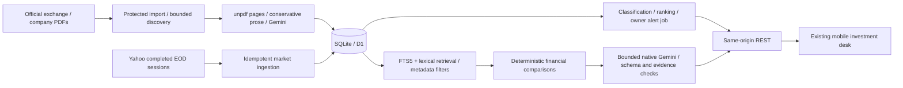

# FINN architecture

The deployed FINN application retains its React/Vinext/Vite Worker architecture and SQLite/D1 runtime. The same code supports the local Worker preview and the public candidate. See [the submission guide](SUBMISSION.md) for the current deployment, verification and operational limits; the component boundaries below remain unchanged.

## Boundaries

- `db/repository.ts` is the runtime-specific SQL adapter and shared parameterized query/batch boundary. D1 supplies SQLite for Worker execution and a persistent local SQLite file through Wrangler.
- `db/schema.ts` defines structured tables, references and indexes. Incremental SQL migrations additionally own FTS5, validation/check constraints, source-page protection triggers and backfills.
- `lib/domain.ts` preserves market calculations, classification, attention scoring and compatible guidance comparison. `lib/periods.ts` selects current/prior/prior-year fiscal periods without a fixed year.
- `lib/financial-extraction.ts` recognizes conservative explicit financial prose and quantified CC guidance. It refuses ambiguous half/nine-month periods and does not infer absent EBITDA.
- `lib/ai/gemini.ts` uses official SDK 2.32.0. `provider.ts` defines strict schemas, task functions and source verification. `service.ts` owns persisted budgets, locks, caches, usage metadata and fact/guidance storage.
- `lib/workflows.ts` connects source ingestion, normalized announcements, owner-specific alert evaluation, guidance/actual matching, derived metrics and operational status.
- `lib/server.ts` retains initialization, retrieval, market adapter and bounded PDF/source discovery. Source ownership and every redirect are checked before indexing.
- The API validates inputs, enforces ownership and protects ingestion. React receives facts/status only, never keys or admin credentials.

## Sessions and preservation

A random HttpOnly cookie is established on the HTML response before concurrent hydration requests. Owner initialization uses an atomic D1 batch: create an owner if absent, conditionally insert its starter watchlist, then mark initialized. Existing owners are backfilled during migration, including empty watchlists recorded in the old metadata. Headers cannot select another owner. Shared company evidence is independent of personal associations.

Notification IDs combine owner, mode and underlying event. Upserts preserve read/dismiss timestamps. Changing a threshold changes future evaluations; it does not rewrite notification history. A protected local batch job evaluates stored owners without an open browser; scheduling and external delivery remain unconfigured.

## Source and AI safety

Only primary documents support company conclusions. A directory can supply links, not financial facts. Hashes deduplicate PDFs. A PDF and its chunks are inserted atomically. Page counts distinguish complete interactive extraction from selected historical pages. Document period labels record whether they are reviewed, source-header-derived or unverified.

Retrieval is restricted by ticker, period and type. FTS5 adds ranked candidates; lexical financial aliases remain a fallback. Gemini receives bounded passages and validated deterministic findings. Claims require genuine source IDs, literal excerpts, matching company and period, and supported numbers. If a broad model summary fails, a separately verified model finding can replace it with a visible limitation. Unverified outputs are omitted or cause explicit fallback. These checks establish source linkage; they cannot prove arbitrary semantic entailment.

Cache keys include company, normalized question, document hashes, complete metric version, retrieval/prompt version, model and filters. Extraction caching is separate from answer caching. Source changes cannot reuse an answer for an old corpus version. Provider failures do not become successful research cache entries.

See [database design](DATABASE_DESIGN.md), [AI pipeline](AI_PIPELINE.md), [verification](VERIFICATION.md) and [limitations](KNOWN_LIMITATIONS.md).

## Reliability revision, 2 November 2026

`lib/ingestion` separates public source adapters, candidate ranking and administrative file batches. NTPC's public dated table is registered as source configuration; financial analysis remains company-independent. Directory links are discovery metadata only; analytical text always comes from original PDFs. Protected jobs bound company and owner work and expose continuation cursors.

`lib/query-plans.ts` builds parameterized FTS and cursor queries. FTS hits are returned directly from SQLite, including late chunks; guidance-target queries retain source-period provenance. Company revision triggers feed selective research keys, together with prompt/model/retrieval versions. Financial selection resolves verified restatements and refuses conflicting facts. New details and all verified results are in [RELIABILITY_UPGRADE.md](RELIABILITY_UPGRADE.md).
