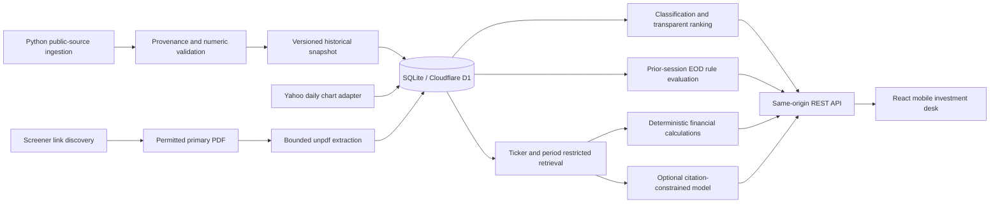

# FINN architecture

FINN is a deliberately small vertical slice of the original ENAM challenge: a windowed portfolio briefing, configurable EOD triggers, primary-source company research, and evidence-linked guidance comparisons.

## Runtime and stack decision

The web app uses React, TypeScript, Next.js App Router conventions, Vinext/Vite, Tailwind, Lucide, Recharts and Zod. Its HTTP handlers run with the interface in one Cloudflare Worker. D1 supplies persistent SQLite; Drizzle owns schema migrations. Python handles source downloading, PDF extraction and an independent calculation audit.

This intentionally adapts the suggested FastAPI/SQLAlchemy split. The available deployment path supports a Worker and D1, so running a second Python service would introduce an unprovisioned backend and an unreliable demonstration. The original challenge imposes no technology stack. The submitted product remains a real frontend/backend system: client components call REST endpoints, and portfolio/rule changes persist server-side. Python is an ingestion/audit tool, not a pretend deployed FastAPI backend.

## Ingestion and provenance

`scripts/ingest.py` downloads public official company PDFs and Yahoo chart observations. It records the original URL, UTC retrieval timestamp, PDF SHA-256, page text and reporting period. Failed sources remain errors. Requests do not bypass access restrictions. `scripts/build-seed.py` produces the bundled historical corpus from successful downloads, validates that each manually reviewed numeric extraction occurs on the indicated PDF page, and retains original page numbers.

Initial import is idempotent. Bounded multi-row inserts seed D1; a version marker prevents repeating the work. Portfolios and alert preferences are scoped to a stable hosted user ID or a random HttpOnly device session. Device records survive reloads and server restarts, but are not shared between different unauthenticated devices. Documents and historical observations are shared immutable reference data.

The bundled corpus contains 18 validated portfolio symbols, 576 EOD observations, 11 primary documents across five companies, 36 reviewed metrics and four briefing updates. Only two companies have curated briefing coverage. This is disclosed in the UI, and an empty digest must never imply complete exchange coverage.

## Push workflow

The briefing filters the investor's portfolio by date, ticker and category. Date-only sources use inclusive calendar-day boundaries rather than inventing publication times. Important disclosures are ordered by an interpretable score, and lower-priority call context remains collapsed. The scoring weights are configurable in `rank()`:

| Component                            | Maximum |
| ------------------------------------ | ------: |
| Reviewed severity                    |      40 |
| Source-supported numerical magnitude |      25 |
| Enabled-category relevance           |      15 |
| Novelty                              |      10 |
| Evidence coverage                    |      10 |

Critical is 75+, Important 50+, Watch 25+, Routine below 25. Scores measure attention, not expected returns. Curated seeds have reviewed categories and rationale; new imports use transparent keyword rules with uncertainty labels. Ambiguous LLM classification is intentionally deferred.

EOD price changes use provider-adjusted closes. Relative volume divides observed volume by the arithmetic average of the **previous N sessions**. Missing or incomplete baselines are unavailable. Every observed session inside the chosen window is evaluated using only its prior history. Global thresholds and company overrides apply, and idempotent alert identifiers prevent repeated stored notifications. Alerts are recalculated on opening the digest; there is no background notification daemon.

## Pull workflow

1. Normalize and validate an arbitrary NSE/BSE symbol. Unknown symbols are resolved with Yahoo's chart metadata.
2. Query stored company documents independently of portfolio membership.
3. On a cache miss, fetch the ticker's Screener page **only as a link directory**, select HTTPS primary PDFs on permitted exchange or verified company hosts, and refuse redirects/access restrictions.
4. Bound each interactive PDF to 8 MB and 500 pages. Extract with unpdf; retain actual PDF page numbers, text chunks and content hash. Scans without text return a limitation rather than a fabricated answer.
5. Retrieve only the requested ticker's passages, with optional exact period/type filters. Lexical scoring expands finance synonyms and deduplicates source pages. Large seeded annual reports index selected relevant pages; new interactive PDFs are bounded by resource limits.
6. Calculate financial findings only from validated metrics on comparable units and accounting bases. Guidance additionally requires identical target/report periods and definitions.
7. Without credentials, return calculated findings and original quotations. A configured model is reserved for qualitative synthesis; numeric questions use deterministic code.
8. Return structured references and limitations. Cache by ticker, document hashes, question, filters, pipeline version and configured model. A changed source hash invalidates old analysis.

No vector service is needed for this corpus. SQLite stores chunks with ticker metadata; a bounded company-level query feeds a simple lexical ranker. This is intentionally inspectable, though less capable than full BM25/semantic retrieval for vague questions.

## Guidance tracker

The initial tracker covers Infosys FY2025 revenue growth and operating margin. January 2025 revised numerical guidance is compared with official full-year results. Revenue uses consolidated constant-currency growth on both sides. Operating margin uses a separate comparable definition. Variance is measured in **percentage points against the closest range boundary**. The tracker preserves qualifiers, links both original pages, and refuses mismatched periods or definitions. It makes no claim about management intent.

## Model boundary

`LLM_BASE_URL`, `LLM_MODEL` and `LLM_API_KEY` configure a server-only provider using the common chat-completion JSON contract. No model credentials are bundled or required. Source passages are serialized as untrusted data in the prompt, and the provider has no tools, secret-reading capability or action execution path. Citation IDs are checked against supplied references. This is a useful guard, not a formal proof of semantic entailment. The credential-free path was exercised end to end; the optional external provider requires independent provider testing after configuration.

## Security and operational boundaries

Admin ingestion is disabled unless `ADMIN_TOKEN` is configured and provided as a bearer token. SQL values are parameterized; ticker/path inputs, settings and request schemas are validated. Documents cannot execute instructions. The app does not fetch arbitrary user-supplied URLs through research. Live and historical observations have separate database keys and are never silently interchanged.

For production beyond this private prototype: enforce request/rate budgets, move large PDF processing to a queue, replace lexical scans with FTS/BM25, schedule approved incremental ingestion, maintain publication-date verification, validate all model claim entailment, and widen filings/guidance coverage before making completeness claims.
