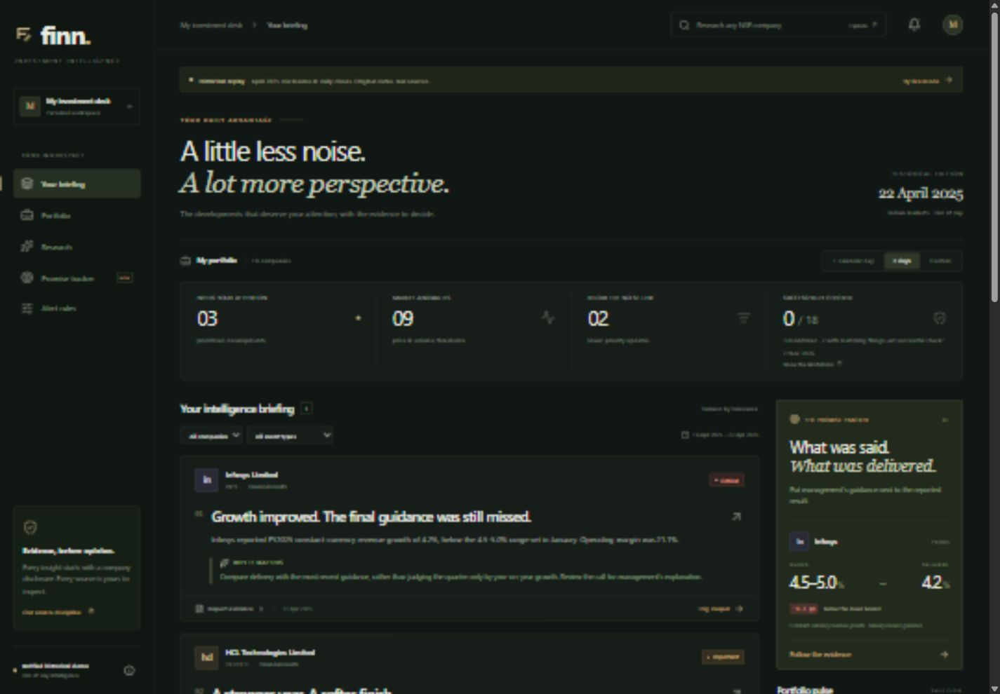
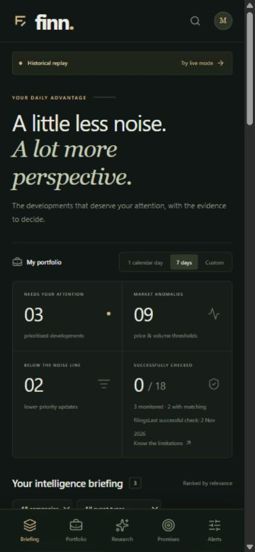

# FINN final corrections and QA — 2 November 2026

Work was performed directly in the existing FINN checkout on `upgrade/sqlite-gemini-push-pull`, starting at `55b235a`. No new application, ZIP extraction, production deployment or GitHub push was performed. The original appearance, routes, 18-company starter portfolio, existing data and `.dev.vars` were retained. Current local review URL: http://127.0.0.1:5173.

## Fixed and independently tested locally

| Area | Implemented correction | Evidence / practical boundary |
| --- | --- | --- |
| Filing coverage | Separate configured monitoring, successful checks in the reporting interval, and companies with matching filtered events. Failed/partial/never-checked states remain distinct; filters do not turn event count into coverage. | SQL/coverage fixtures and HTTP/browser checks. Live UI showed 3 configured sources, 2 successful checks and 0 matching companies on the same day. Historical checks correctly remained 0. |
| Complete briefing | Full SQL aggregate counts; separate stable priority/date/ID seek cursors for important and routine sections; independent View more controls. | Traversed all 367 isolated fixture events without duplicates; 244 important plus 123 routine. Existing announcement-feed test also traverses 620 records. |
| Completed EOD | IST dates, valid OHLC/adjusted close/volume, provider close/observation metadata, official NSE 2026 calendar, special sessions, 20-minute buffer. Current completed bars are accepted after verification; incomplete bars are excluded. | Clock-injected before/during/after-close, delay, missing-data, weekend/holiday and UTC rollover cases. Adjusted-price and full-prior-window volume calculations retained. Market API and research chart expose stored session/check status. |
| Event evidence | Event-specific exact page passages; multiple categories per filing; unsupported events require review. No automatic page-1 evidence substitution. | Multi-page results/dividend/management fixture; real same-page Infosys results/dividend regression; genuine NTPC/SBI/Maruti imports. |
| Resumable discovery | Discovery cursor is independent of the durable pending/failed/review queue. Always revisit the newest head while continuing older pages. Attempts/cooldowns prevent endless retry loops. | 186-record discovery fixture including a new head during backfill. Genuine SBI discovery imported 0 events; separate ingestion imported 2 and retained 4 pending. |
| Materiality | Distinguish senior role/action and rating direction; use a unique event-role amount against a dated compatible verified annual company measure when available; preserve source IDs/pages/units and factual reasons. | Relative-scale/unknown/company-mismatch tests plus existing absolute-scale regression. Real events without a compatible scale reference retain absolute/unknown magnitude; no price prediction. |
| PULL and queues | Question/type/period/text/recency/completeness ranking, runtime indexed-document metadata, discovery when a requested type is missing, one interactive download and durable background jobs. Protected queue listing/processing, atomic claims, stale-job recovery, bounded retries. | Newly discovered Electrosteel transcript outside both starter/preload sets; 324-page original annual report processed in 9 seconds locally, 323 nonempty text pages correctly marked partial. No reliable annual table metrics were fabricated. |
| Financial extraction | Scoped basis/unit/period columns, day-first date headers, explicitly continued tables, signed values, conservative ambiguity rejection. Preserve existing prose and reviewed data. | Mixed consolidated/standalone crore/million tables, continued page and unrelated-page rejection; original DMart prose, HCL guidance and Britannia transcript audits. |
| Accounting definitions | Total income is not Revenue; EBITDA margin is not Operating margin; gross/net debt is not automatically Borrowings. Preserve source decimals. | New definition/precision regressions. Earlier affected Gemini rows retained as unverified with audit records. PAT 48.4 no longer renders as 48. |
| Gemini and fallback | Native SDK retained; compact metric input avoids repeating full evidence pages; preserve deterministic findings and label reported/calculated/commentary/interpretation. Explicit rejected/unavailable output remains extractive. | Three credentialed model tests pass; difficult growth, original/revised guidance, cash-quality and risk questions exercised. No successful synthesis is claimed for a rejected response. |
| Fresh demo | Fixed original-source bundle and protected idempotent preparation command; no user portfolio/settings writes or fabricated sync success. | Empty migrated production-preview DB: 11 original documents → 17; 6 added documents, 38 source-checked financial rows, 2 guidance statements, 8 events; repeated preparation kept counts unchanged and preserved 18 companies. |
| Jobs | Separated discovery, ingestion, market refresh, extraction/queue retry and owner evaluation; local checkpoint and bounded `--drain`/`--resume`. | Nine real owner-evaluation requests all returned 200 and reached completion; resume stopped at the saved completed checkpoint. Protected job listing returned 200. |
| Durability/security | Incremental schema only, original relational constraints, source hashes/pages, owner isolation, protected admin jobs, same-origin validation, bounded bodies/PDFs, HTTPS/public source restrictions. | Original API isolation/concurrency/source-failure suites pass; actual server restart and SQLite backup/recovery checks pass. No credential values enter the source bundle or frontend. |
| UI | Original design preserved; truthful coverage labels, complete counts, separate pagination, live EOD wording and research evidence labels/freshness. | Desktop 1440px and mobile 375px inspection: no horizontal overflow; mobile navigation present. Screenshots below. |

## Implemented but requires external integration verification

- Hosted D1/Worker migration, deployment environment bindings, production concurrency/quotas and scheduled execution must be verified during an authorized deployment. Local SQLite/production-preview checks do not prove hosted behavior.
- Future exchange-calendar years, newly announced special sessions and future provider publication delays require continued primary-source/calendar maintenance. No cloud schedule was activated.

## Partially implemented with stated limitations

- Automatic announcement coverage is limited to registered NTPC, the SBI October–December 2026 page, and dated Maruti CMS records. These represent power, banking and automotive layouts; they are not portfolio-wide or exchange-wide completeness. SBI registration needs review after its quarter ends. Maruti imported a dated original filing but another original PDF returned HTTP 406; many CMS records have no authoritative date and remain review items. Access restrictions were respected.
- Previously unseen Electrosteel PULL completed discovery, original PDF ingestion, native extraction, retrieval and Gemini synthesis with page citations. A clean production-preview run accepted four structured metric rows and correctly answered Q1 FY2027 total income 1,465, EBITDA 139 and PAT 48.4 (Rs crore). The first pass did not persist the structured Total income row; the exact primary passage still supported that correctly labelled research finding. A controlled local re-extraction accepted that distinct metric. Individual field extraction is conservative and not guaranteed complete.
- Arbitrary flattened/scanned tables, synonymous accounting labels, exhaustive annual-report coverage, several distinct same-category actions on one page, and mutable/reused issuer URLs can still need reviewed import. URL-level candidates do not provide an immutable exchange change log. Some questions have insufficient source facts. Total income is not substituted into a revenue-growth calculation.
- Source-relative materiality requires an actually available, compatible dated annual reference; missing scale data remains explicit. Automated source checks are not full semantic entailment or a financial audit.

## Intentionally excluded

Production deployment/push, cloud scheduling activation, phone/SMS/browser push subscriptions, OCR, semantic embeddings and automated management biographies. Existing durable in-app alerts remain available.

## Database and recovery

Safe incremental migrations: `0006_stiff_enchantress.sql` (source provenance/progress and document jobs), `0007_wandering_thor.sql` (original optional source timestamp). Applied SQL 0000–0005 was not edited. Drizzle journal/snapshots are included. Financial definition review v4 changes verification status with an audit reason and preserves the original rows.

Backups preceded both migrations. Applying 0006/0007 to a copy of the populated pre-upgrade database preserved counts in all 31 existing tables, including 194 owners, 30 documents and 137 metric history rows. Integrity was `ok`; FK violations were 0. A consistency-aware VACUUM snapshot reopened successfully. Empty and original seeded/custom-owner migration tests also pass. An actual localhost restart preserved portfolios, settings, dismissed alerts, source documents/chunks, metrics, guidance, sync ledgers, queued jobs and cached research. Test DBs/snapshots never replace the working DB.

Backup: `npm run db:backup`. Stop the local runtime for restore; preserve the current file and sidecars separately, restore the chosen snapshot to the same D1 filename, then apply only missing migrations and restart. See [database details](DATABASE_DESIGN.md). Backups and `.dev.vars` are ignored and excluded from Git.

## Verification results

94 automated tests passed, 0 failed, 0 skipped across the executed suites:

| Command | Passed |
| --- | ---: |
| `npm test` | 69 |
| `npm run test:api` | 15 |
| `npm run test:reliability-api` | 4 |
| `npm run test:ingestion` | 1 |
| `npm run test:gemini` | 3 credentialed native calls |
| `npm run test:cache` with a fresh isolated localhost URL | 1 |
| `npm run test:demo` with an empty isolated localhost URL | 1 |

`npm run typecheck`, `npm run lint` (no errors or warnings), and `npm run build` pass. Independent Python checks validated 18 market summaries/8 original comparisons, 9 DMart consolidated source values/6 percentage calculations, and 5 Britannia transcript values. PBT/EBITDA remain unavailable where their precise definitions are not established.

Additional actual integration checks: genuine dated SBI and Maruti imports, separated stages, resumable owner traversal, large-report background processing, fresh unfamiliar-company PULL, populated migration/recovery, restart durability, and responsive browser inspection. Local raw run artifacts are retained in ignored `.sites-runtime/corrections-*`; they are not required to prepare the bundled demo.

Gemini model actually executed: `gemini-3.5-flash-lite`, native `@google/genai`; current prompt/cache version `finn-evidence-v7`. The verified Electrosteel answer used 6,292 input/738 output tokens in one recorded local run. Model/project quotas and future outputs remain variable; unsupported outputs are rejected rather than guaranteed to pass.

Primary references used for source/calendar validation: [NSE 2026 holidays](https://nsearchives.nseindia.com/content/circulars/CMTR71775.pdf), [January 15 amendment](https://nsearchives.nseindia.com/content/circulars/CMTR72260.pdf), [February 1 budget session](https://nsearchives.nseindia.com/content/circulars/CMTR72349.pdf), [SBI quarterly disclosures](https://sbi.bank.in/web/corporate-governance/3rd-quarter-2026-27). Original filing URLs and hashes remain in the source records/bundle; Electrosteel numerical findings cite PDF page 4 of the original BSE transcript.

## Local readiness and review

Use [DEMO.md](DEMO.md) for reproducible preparation and job commands. The existing localhost app is left running on port 5173 for user testing; temporary production previews are stopped. Nothing is pushed or deployed. Coverage and extraction limitations above remain visible and should be assessed before any production release.

## Modified files

- `README.md`
- `app/api/[...path]/route.ts`
- `components/Briefing.tsx`
- `components/Dashboard.tsx`
- `components/Evidence.tsx`
- `components/PromiseTracker.tsx`
- `components/Research.tsx`
- `data/announcement-sources.json`
- `data/demo-evidence.json`
- `db/schema.ts`
- `docs/AI_PIPELINE.md`
- `docs/DATABASE_DESIGN.md`
- `docs/DEMO.md`
- `docs/FINAL_CORRECTIONS_CHECKLIST.md`
- `docs/FINAL_CORRECTIONS_REPORT.md`
- `docs/KNOWN_LIMITATIONS.md`
- `docs/VERIFICATION.md`
- `docs/screenshots/final-corrections-desktop.png`
- `docs/screenshots/final-corrections-mobile.png`
- `drizzle/0006_stiff_enchantress.sql`
- `drizzle/0007_wandering_thor.sql`
- `drizzle/meta/0006_snapshot.json`
- `drizzle/meta/0007_snapshot.json`
- `drizzle/meta/_journal.json`
- `lib/ai/gemini.ts`
- `lib/ai/provider.ts`
- `lib/ai/service.ts`
- `lib/briefing-query.ts`
- `lib/demo.ts`
- `lib/domain.ts`
- `lib/event-analysis.ts`
- `lib/event-evidence.ts`
- `lib/financial-extraction.ts`
- `lib/financial-labels.ts`
- `lib/ingestion/adapters.ts`
- `lib/ingestion/announcements.ts`
- `lib/ingestion/discovery.ts`
- `lib/ingestion/document-jobs.ts`
- `lib/market-sessions.ts`
- `lib/research-analysis.ts`
- `lib/server.ts`
- `lib/types.ts`
- `lib/workflows.ts`
- `package.json`
- `scripts/prepare-demo.mjs`
- `scripts/run-local-job.mjs`
- `tests/api.test.mjs`
- `tests/corrections.test.ts`
- `tests/database.test.mjs`
- `tests/demo.integration.test.mjs`
- `tests/reliability.test.ts`
