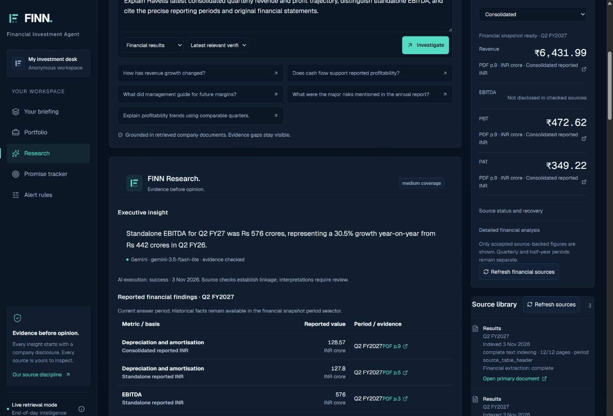

# FINN — ENAM Holdings reviewer guide

**[Open the public demo](https://finn-enam-final-mrity.hazyanole2049.chatgpt.site/)** · **[GitHub source](https://github.com/mrityunjaykumar23/FINN)** · **[Verification evidence](test-results/submission/README.md)**

The application opens without signup. Its original 18-company starter watchlist is assigned once per visitor. Latest EOD is the default; use Historical Replay when reviewing the labelled April 2025 examples.

## Suggested review — five minutes

1. **Briefing:** inspect a current source-backed event and its evidence. To reproduce the verified ITC example, choose ITC and a custom **2 November 2026** window in Latest mode. Two independent disclosures retain their own event identities and date-only publication precision.
2. **Portfolio:** inspect stored closing prices, daily changes and source freshness. Add a supported company by name, refresh the page, then remove it if desired. Prices are completed EOD observations.
3. **Research:** search **Havells** without adding it to the portfolio. Select Financial results and ask: “Explain Havells latest consolidated quarterly revenue and profit trajectory, distinguish standalone EBITDA, and cite the precise reporting periods and original financial statements.” Inspect the actual AI execution status, reporting periods and original page links.
4. **Financial Snapshot:** search **Ajanta Pharma**. The verified consolidated Q2 FY2027 snapshot contains Revenue ₹1,794 crore, EBITDA ₹543 crore, PBT ₹535 crore and PAT ₹388 crore. These retain the rounding of the cited originals. Change the accounting basis: unavailable standalone figures must not reuse consolidated values.
5. **Promise Tracker:** explicitly select Historical Replay. Inspect Infosys' 4.5–5% revised FY2025 CC revenue-growth range against the reported 4.2%, with both original sources. HCLTech's original/revised targets retain superseded labels. Restore Latest EOD afterward.
6. **Alerts/mobile:** inspect notification history, mark an alert read/unread, and visit all five navigation sections. Existing notification history survives settings changes.

Current source availability and new disclosures can change what appears after the recorded verification date. Missing evidence remains visible rather than becoming an invented figure or a successful empty source check.

## Verified public release — 3 November 2026

| Item | Verified value |
| --- | --- |
| Current demo | https://finn-enam-final-mrity.hazyanole2049.chatgpt.site/ |
| Repository / branch | [mrityunjaykumar23/FINN](https://github.com/mrityunjaykumar23/FINN), `main` |
| Deployed application commit | [`18416e11742d8478fc017928900bdd520407b08f`](https://github.com/mrityunjaykumar23/FINN/commit/18416e11742d8478fc017928900bdd520407b08f) |
| Sites version | **4**, deployment succeeded |
| Version identifier | `appgprj_6ae9b8987a3c8191b95f93bdf3aeee5c~appgver_f8b3997674d48191adb4fe7ecb523012` |
| Deployment identifier | `appgdep_6ae9c2c396e081918bbd2ffdb94949c8` |
| Persistence | Separate hosted D1 database using the existing migration chain through `0012` |
| Secrets | Server-side, masked Sites secrets; deployed environment revision 1 |

The application/runtime source on `main` matches the deployed application commit above. Later submission changes update Markdown documentation, screenshots and verification evidence only. This distinction preserves exact build provenance without describing a documentation-only commit as a new deployed build.

## What was actually executed

| Check | Result |
| --- | --- |
| Public health and Latest default | Passed with localhost stopped |
| Market data | All 18 starter companies priced; actual Yahoo refresh returned 64 sessions; latest stored session was 3 November 2026 |
| Company management | Search, idempotent add/remove and persistence passed; mobile add survived a full page reload |
| Havells PULL | Discovery → indexing → extraction → real Gemini synthesis completed in about 40.4 seconds after hosted fixes |
| Gemini evidence | `ai_status: success`, `gemini-3.5-flash-lite`, 7,659 input / 1,176 output tokens, eight page citations checked against indexed original text |
| Rendered research | A separate request through the public mobile UI displayed successful Gemini research and source-linked financial findings |
| Ajanta | All four consolidated Q2 FY2027 metrics accepted; period/basis switching and evidence gaps rendered correctly |
| Authentic PUSH | Two 2 November ITC events reached briefing, inspected evidence and durable alerts |
| Promise Tracker | Four historical guidance/result comparisons with original-source evidence |
| Persistence | Watchlist survived reload; filings, metrics and guidance survived successive source-only deployments |
| Responsive UI | Five mobile sections exercised; research report had no horizontal overflow at 320, 375 and 1440 pixels |
| Source links | Original Havells and Infosys PDF URLs returned HTTP 200 with PDF bytes |
| Protected jobs | Unauthenticated calls rejected with 403; market, discovery, ingestion, documents and evaluation phases exercised |

TypeScript, lint and production builds passed. The recorded local checks include **109 unit/database tests**, **17 API tests**, one durable-job test and one served-Worker contention/batch-boundary regression. The complete earlier base-release run had 136 passing named tests; affected checks were rerun during the hosted corrections, with unchanged checks reused. Independent financial audits verified 18 market summaries, eight quarterly comparisons, nine DMART source figures with six calculations, and five Britannia source figures.

The final recorded readback contained **33 documents, 2,376 chunks, 19 announcements, 306 financial metric records and four guidance statements**. Legitimate on-demand indexing can increase those counts. Independent originals may hold separate records for the same metric; selected snapshot facts are not summed together.

## Reliability corrections verified on the host

- Shared discovery contention/cooldowns keep research resumable instead of permanently failing it.
- A shared 20-second retrieval deadline retains primary links already found when an issuer crawl stalls.
- Candidate upserts use bounded D1 batches of 50, avoiding hundreds of sequential round trips. The regression verifies all 60 fixture candidates across a batch boundary.
- Actual hosted research failures and transient connection resets were investigated before successful final acceptance. A fallback was not counted as a real Gemini pass.

## Operational limits and data preservation

- **Unattended recurring scheduling is not enabled.** Protected update phases passed, but future cloud-task credential access remains unverified.
- Disclosure coverage is issuer-dependent; four dated announcement adapters and directory discovery do not constitute a complete exchange feed. Some sources or financial extractions remain partial/manual.
- Figures retain original units, periods, accounting bases and rounding. Unsupported metrics remain unavailable; scanned documents have no OCR pipeline.
- Workspaces use anonymous visitor cookies; phone/browser push and authenticated multi-device accounts are not implemented.
- The older public Site and its database remain preserved. A complete supported export/restore point for that database was unavailable through the connected tooling, so the approved new-URL fallback used a separate D1 database. Previous visitors' personal portfolios were not automatically transferred.

See [current limitations](KNOWN_LIMITATIONS.md), [local reproduction](DEMO.md), [architecture](ARCHITECTURE.md) and the [submission note](COVERING_NOTE.md). Earlier dated audits are retained as development history, not substituted for the current live evidence.
